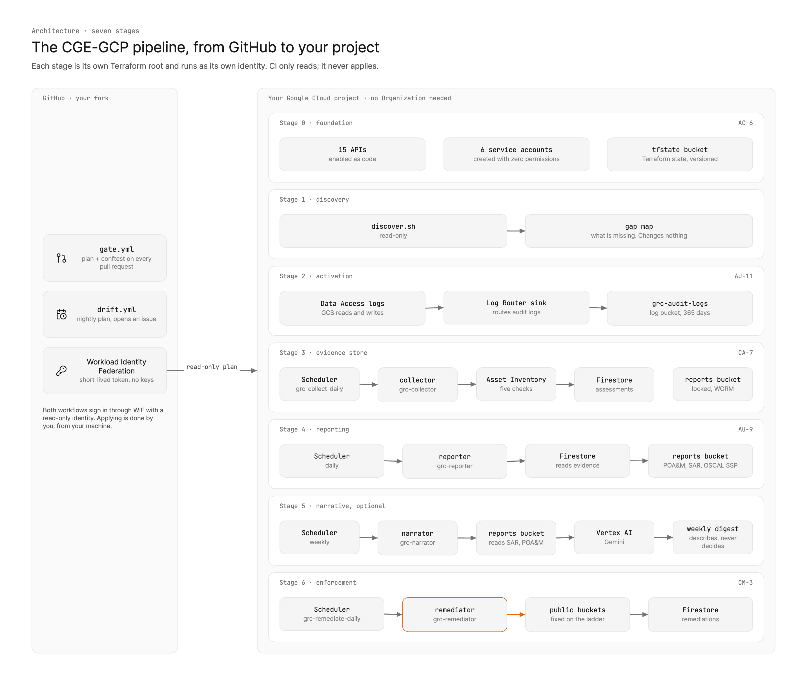

# Diagrams

Course diagrams for CGE-GCP, drawn in the [GRC Engineering Club](https://github.com/GRCEngClub/design-system) style. They're drawn from the code in this repo, so if a stage, role or rule changes, update the diagram as well.

| # | Diagram | Use it with |
|---|---|---|
| 1 | [Pipeline architecture](01-pipeline-architecture.png): all seven stages, the GitHub side and WIF | `README.md`, Lab 1 |
| 2 | [Identities and least privilege](02-identities-least-privilege.png): each service account, its exact grants, and the AC-5 split | Lab 3, `docs/CONTROLS.md` (blast radius) |
| 3 | [Daily loop](03-daily-loop-sequence.png): collect, remediate, re-collect, report | Labs 4–6 |
| 4 | [Remediation ladder](04-remediation-ladder.png): `report_only` / `approve` / `auto`, and the recurrence rule | Lab 6 |
| 5 | [CI gate and drift](05-ci-gate-and-drift.png): `gate.yml`, `drift.yml`, the rego rules | Lab 3, Lab 6 step 6 |
| 6 | [Firestore data model](06-firestore-data-model.png): `frameworks`, `mappings`, `assessments`, `remediations` | Labs 4–5 |

Every diagram comes in two versions: `NN-name.png` (light) and `NN-name-dark.png` (dark). To embed one so GitHub shows the version that matches the reader's theme:

```html
<picture>
  <source media="(prefers-color-scheme: dark)" srcset="docs/diagrams/01-pipeline-architecture-dark.png">
  
</picture>
```

<picture>
  <source media="(prefers-color-scheme: dark)" srcset="01-pipeline-architecture-dark.png">
  
</picture>

## Editing a diagram

The diagrams are code. Each PNG pair is built from one script in [`src/`](src/) with the same number, rendered by the open-source [eraser-diagrams](https://github.com/eraserlabs/eraser-diagrams) CLI. You don't need an Eraser account.

```sh
cd docs/diagrams
npm install            # once; installs the pinned CLI (it drives a local Chromium)
npm run build          # rebuild all twelve PNGs
npm run build -- 04    # rebuild just diagram 04, light and dark
```

| File | What it holds |
|---|---|
| `src/club.mjs` | The club palette (light and dark) and the shared pieces: `card`, `band`, `arrow`, `text`. Change a color here and every diagram follows. |
| `src/NN-*.mjs` | One diagram. The wording lives in plain arrays at the top; layout constants sit just below. Most edits are text changes in those arrays. |
| `build.mjs` | Renders each script once per theme at 2×, then writes `NN-name.png` and `NN-name-dark.png`. The build fails on an unknown icon name. |

Rules that keep these readable (and keep the lines from crossing):

- One row or band per actor or step. Arrows run inside a band and never jump across to another one.
- When two bands use the same resource (Firestore, the reports bucket), draw it again in each band. Don't send both bands' arrows to one shared box.
- Orange marks the one thing that matters in each diagram (usually `grc-remediator`, the only identity that changes resources). Everything else stays neutral.
- Labels come from the code: role names from `stages/*/main.tf`, check IDs from `functions/collector/controls.json`, control IDs from `docs/CONTROLS.md`. If you change one there, change it here too.
- Club writing style: sentence case, no trailing periods on short labels, mono type for identifiers and control tags.

Icons are names from Eraser's icon set (`https://storage.googleapis.com/eraser-public-assets/canvas-icons/<name>.svg`). Commit the script and both PNGs together.
